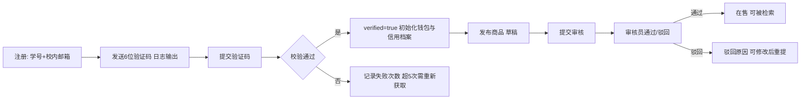
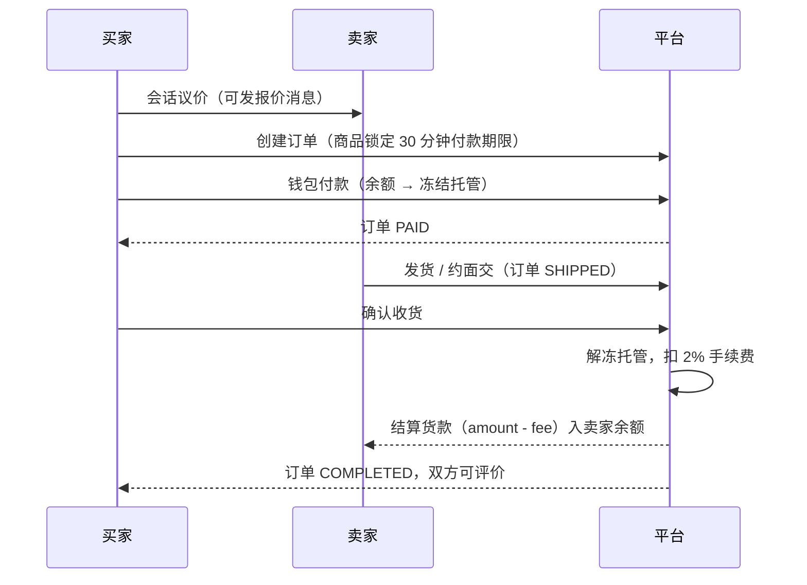
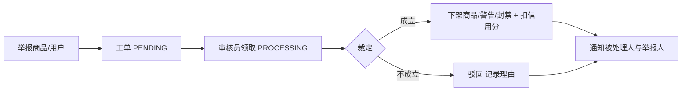
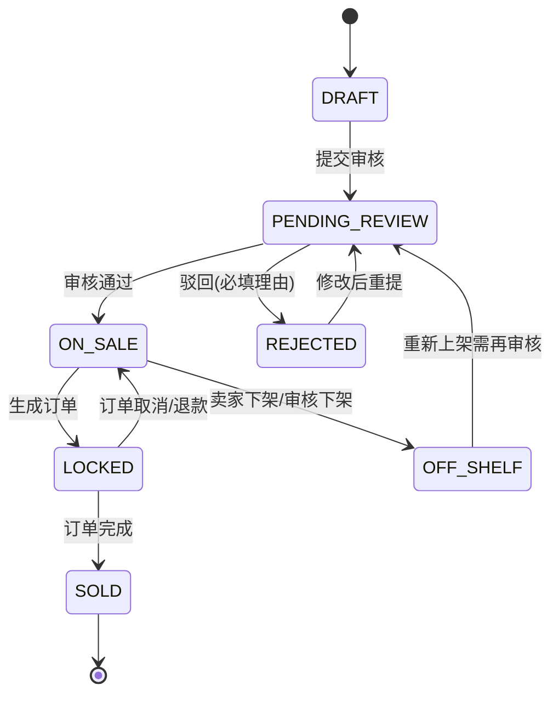
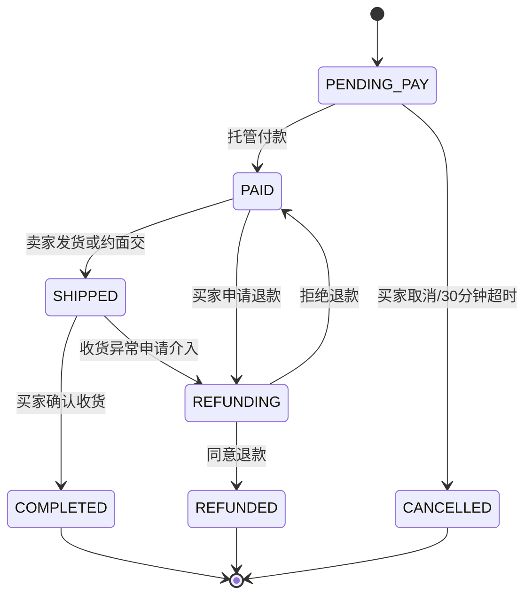

# 校园集 Campus Market — 产品需求文档（PRD）

| 项目 | 内容 |
| --- | --- |
| 产品名称 | 校园集（campus-market） |
| 一句话定位 | 面向在校学生的二手闲置交易与信用评价平台，平台托管资金、审核商品、沉淀信用 |
| 版本 | v1.0 |
| 文档状态 | 已定稿，作为 `docs/TECH_DESIGN.md` 与代码实现的唯一需求来源 |
| 目标读者 | 开发、评审老师、演示观众 |

---

## 1. 背景与目标

### 1.1 背景

校园二手交易长期依赖微信群和贴吧：商品没有结构化管理，交易靠口头约定，纠纷无凭证，卖家信用不可见。学生把教材、数码、宿舍用品挂出后，常见问题是「挂上去没人看」「约好被放鸽子」「钱付了东西不对」。

### 1.2 产品目标

1. 把「发布 → 审核 → 议价 → 托管付款 → 收货 → 评价」固化成一条可追踪的流程，每一步都有状态和时间戳。
2. 用钱包托管消除「先给钱还是先给货」的信任问题，确认收货后才结算给卖家。
3. 用信用分把历史行为量化，低信用用户受到发布数量限制，形成正反馈。
4. 用审核队列与举报工单把违规内容挡在交易之前。

### 1.3 成功标准（演示验收标准）

- 一个完整交易可以在 5 分钟内被完整演示：注册 → 认证 → 发布 → 审核通过 → 议价 → 下单付款 → 发货 → 确认收货 → 双向评价 → 信用分变化 → 后台看板数据更新。
- 任何非法状态跳转（例如未付款直接确认收货）都会被后端拒绝并返回业务错误码。
- 审核员、管理员与普通学生看到的功能与菜单不同，越权访问返回 403。

---

## 2. 用户角色与权限矩阵

| 角色 | 说明 | 核心能力 |
| --- | --- | --- |
| 游客 | 未登录 | 浏览商品列表、商品详情、分类、卖家公开信用档案 |
| 未认证学生 | 已注册，未完成校园认证 | 浏览 + 收藏；不能发布、下单、评价、聊天 |
| 认证学生 STUDENT | 通过学号 + 校内邮箱验证 | 买卖一体：发布、下单、付款、聊天、评价、举报、查看钱包 |
| 审核员 MODERATOR | 平台运营 | 商品审核、举报工单处理、下架商品、警告/封禁用户、查看审计日志 |
| 管理员 ADMIN | 平台负责人 | 审核员全部权限 + 类目管理、用户角色调整、数据看板、平台钱包 |

权限矩阵（✓ 允许，— 禁止）：

| 功能 | 游客 | 未认证 | 学生 | 审核员 | 管理员 |
| --- | --- | --- | --- | --- | --- |
| 浏览商品/详情/分类 | ✓ | ✓ | ✓ | ✓ | ✓ |
| 收藏 | — | ✓ | ✓ | ✓ | ✓ |
| 发布/编辑商品 | — | — | ✓ | ✓ | ✓ |
| 下单/付款/退款 | — | — | ✓ | ✓ | ✓ |
| 聊天议价 | — | — | ✓ | ✓ | ✓ |
| 评价 | — | — | ✓ | ✓ | ✓ |
| 举报 | — | — | ✓ | ✓ | ✓ |
| 商品审核 | — | — | — | ✓ | ✓ |
| 举报工单处理 | — | — | — | ✓ | ✓ |
| 用户警告/封禁 | — | — | — | ✓ | ✓ |
| 类目管理 | — | — | — | — | ✓ |
| 角色调整 | — | — | — | — | ✓ |
| 数据看板 | — | — | — | ✓ | ✓ |
| 审计日志 | — | — | — | ✓ | ✓ |

---

## 3. 核心业务流程

### 3.1 认证与发布



### 3.2 交易托管全链路



### 3.3 退款与超时

- 未付款超过 30 分钟：定时任务把订单置为 `CANCELLED`，商品回到 `ON_SALE`。
- 已付款未发货申请退款：订单进入 `REFUNDING`，卖家同意或审核员介入裁定；同意后托管金额原路退回买家余额，商品回 `ON_SALE`。
- 已发货申请退款：必须走审核员工单裁定，裁定结果写入 `order_status_log`。

### 3.4 举报与处置



---

## 4. 状态机

### 4.1 商品状态



### 4.2 订单状态



### 4.3 举报工单状态

`PENDING → PROCESSING → RESOLVED | REJECTED`，任何状态都可被管理员 `REOPENED`。

---

## 5. 功能需求

### 5.1 P0（必须交付）

| 编号 | 模块 | 需求描述 |
| --- | --- | --- |
| F-01 | 账号 | 学号 + 昵称 + 校内邮箱 + 密码注册，密码 BCrypt 存储，学号与邮箱唯一 |
| F-02 | 账号 | 登录返回 accessToken（30 分钟）与 refreshToken（7 天），支持刷新、退出（refreshToken 失效） |
| F-03 | 账号 | 校园认证：向校内邮箱发送 6 位验证码（写入日志），有效期 10 分钟，最多 5 次尝试 |
| F-04 | 账号 | 个人资料：昵称、头像、简介、校区；修改密码 |
| F-05 | 商品 | 新建草稿，最多 9 张图片，单图 ≤ 5MB，仅 jpg/png/webp |
| F-06 | 商品 | 提交审核；审核员通过或驳回并填写驳回理由 |
| F-07 | 商品 | 卖家编辑（仅在 DRAFT/REJECTED/ON_SALE 下允许）、下架、重新提交审核 |
| F-08 | 检索 | 关键词（标题/描述）、分类、价格区间、成色、排序（最新/价格升降/热度）与分页 |
| F-09 | 收藏 | 收藏/取消收藏，我的收藏列表，商品收藏数 |
| F-10 | 推荐 | 商品详情页推荐同分类在售商品（最多 6 条） |
| F-11 | 聊天 | 以商品为维度创建买卖会话，发送文本与报价消息，未读计数，轮询拉取新消息 |
| F-12 | 订单 | 创建订单锁定商品，30 分钟付款期限，付款前可取消 |
| F-13 | 钱包 | 余额、冻结金额、流水列表；演示用充值接口 |
| F-14 | 订单 | 钱包余额托管付款（余额不足报错），卖家发货/约面交，买家确认收货，平台扣 2% 手续费后结算 |
| F-15 | 订单 | 申请退款、卖家同意/拒绝、审核员裁定，托管金额原路退回 |
| F-16 | 订单 | 定时任务处理超时未付款订单，释放商品 |
| F-17 | 评价 | 订单完成后 7 天内双向评价，评分 1-5 + 标签 + 文字，每单每方一次 |
| F-18 | 信用 | 信用分按公式重算并写入档案，展示成交数、好评率、徽章、最近评价 |
| F-19 | 信用 | 信用分 < 60 禁止发布；60-89 同时最多 3 件在售；≥ 90 不限 |
| F-20 | 风控 | 举报商品/用户，填写原因类型与描述，生成工单 |
| F-21 | 风控 | 审核员处理工单：成立则下架商品/警告/封禁并扣分，驳回需填理由 |
| F-22 | 风控 | 关键操作写审计日志（审核、封禁、退款裁定、角色变更） |
| F-23 | 通知 | 审核结果、订单状态、举报处理、评价到达时产生站内通知，未读数轮询 |
| F-24 | 后台 | 审核队列、举报工单、用户管理（警告/封禁/角色）、类目管理（增删改、启用禁用） |
| F-25 | 后台 | 数据看板：GMV、订单量、成交率、新增用户、类目分布、近 7 天趋势 |

### 5.2 P1（有余力则做）

| 编号 | 需求描述 |
| --- | --- |
| P1-01 | WebSocket 实时聊天替代轮询 |
| P1-02 | 商品图片压缩与缩略图 |
| P1-03 | 信用分变动明细时间线 |
| P1-04 | 导出订单 CSV |
| P1-05 | 敏感词过滤与自动预审 |

### 5.3 范围外

真实支付渠道、物流对接、短信/邮件真实发送、多校区多租户、移动端原生 App、搜索引擎（Elasticsearch）。

---

## 6. 业务规则

### 6.1 交易规则

1. 商品同一时刻只能有一个有效订单；下单即把商品置为 `LOCKED`。
2. 买家不能购买自己发布的商品；卖家未认证不能发布，买家未认证不能下单。
3. 付款期限 30 分钟，超时订单自动取消并释放商品。
4. 平台手续费 = 订单金额 × 2%，四舍五入到分；卖家实收 = 金额 - 手续费。
5. 资金流向全部通过钱包流水记录，任何余额变动必须有一条流水。
6. 订单完成后 7 天内可评价，超时视为放弃；同一订单同一方向只能评价一次。

### 6.2 信用分公式（实现见 `docs/TECH_DESIGN.md` §6）

```
评分项    = 0.6 × (平均评分 / 5 × 100) + 0.4 × 履约率 × 100
扣分项    = 纠纷数 × 5 + 举报成立数 × 3 + 封禁记录 × 10
信用分    = clamp(round(评分项 - 扣分项), 0, 100)
无评价用户 = 80 - 扣分项（下限 0）
```

- 履约率 = 完成订单数 / (完成 + 取消 + 退款) ，无订单时按 60% 计。
- 徽章：≥ 95 精英；85-94 可靠；70-84 普通；< 70 观察期。
- 信用分变化即时重算，并写入 `reputation` 表。

### 6.3 审核规则

1. 商品提交审核后进入队列，审核员看不到卖家身份以外的隐私字段。
2. 驳回必须填写 5-100 字理由，并通知卖家。
3. 被举报成立的商品直接下架，累计 3 次成立则封禁卖家 7 天。

---

## 7. 页面清单

### 7.1 学生端（12 个）

1. 首页 / 商品瀑布流 + 分类快捷入口
2. 商品搜索与筛选结果页
3. 商品详情页（含卖家信用卡、议价入口、推荐位）
4. 登录页
5. 注册页（含校园认证步骤）
6. 发布商品页（草稿保存、图片上传）
7. 我的商品（按状态分组：草稿/待审/在售/交易中/已售/已下架）
8. 我的订单（买到的 / 卖出的，按状态筛选）
9. 订单详情（状态时间线、付款/发货/确认收货/退款按钮）
10. 会话列表 + 聊天页（同一页面左右布局）
11. 我的收藏
12. 个人中心 / 信用档案（含钱包、通知、资料编辑）

### 7.2 后台（5 个）

1. 数据看板
2. 商品审核队列
3. 举报工单
4. 用户管理
5. 类目管理

---

## 8. 非功能需求

| 类别 | 要求 |
| --- | --- |
| 性能 | 商品列表接口 P95 < 300ms（本地 1 万条数据）；分页大小上限 50 |
| 并发 | 同一商品并发下单只能成功一个；钱包扣款使用乐观锁，失败重试 3 次 |
| 安全 | 密码 BCrypt；JWT 签名 HS256；所有写操作校验归属；文件上传校验类型与大小；SQL 全部参数化 |
| 一致性 | 资金与订单状态在同一事务内变更；状态机非法跳转抛业务异常 |
| 可观测 | 每个响应带 `X-Trace-Id`，日志格式包含 traceId |
| 可用性 | 前端所有异步操作有 loading 与错误提示；表单校验即时反馈 |
| 兼容性 | Chrome/Edge 最新版；后端 JDK 17；MySQL 8.0 |

---

## 9. 验收标准

| 编号 | 场景 | 期望 |
| --- | --- | --- |
| A-01 | 未认证用户调用发布接口 | 403 + 业务码提示需先完成校园认证 |
| A-02 | 审核员驳回不填理由 | 400 参数校验失败 |
| A-03 | 买家余额 100 元，购买 200 元商品 | 400「余额不足」，订单仍为 PENDING_PAY |
| A-04 | 两个买家同时购买同一商品 | 一个成功，另一个收到「商品已被下单」 |
| A-05 | 重复点击确认收货 | 第二次返回「订单状态不允许该操作」 |
| A-06 | 买家访问他人订单详情 | 403 |
| A-07 | 完成订单后卖家实收 | 金额 × 98%，平台钱包增加 2% |
| A-08 | 未付款订单 30 分钟 | 自动 CANCELLED，商品回 ON_SALE |
| A-09 | 5 星好评后信用分 | 按公式重算且徽章随之变化 |
| A-10 | 信用分 55 的用户发布商品 | 拒绝并提示信用不足 |
