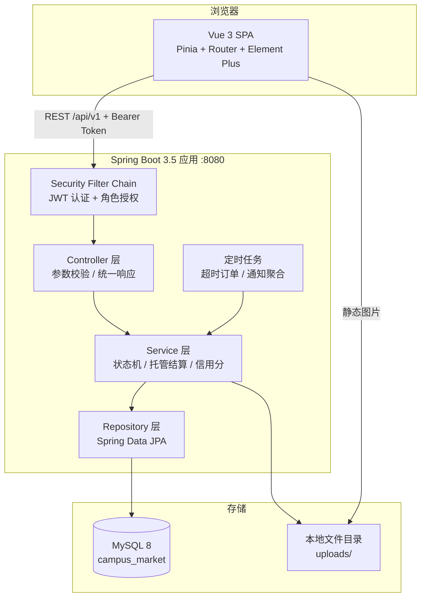
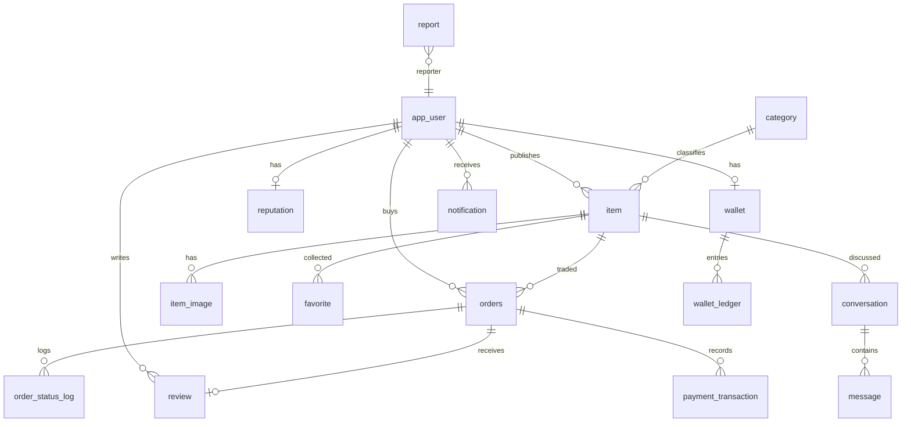
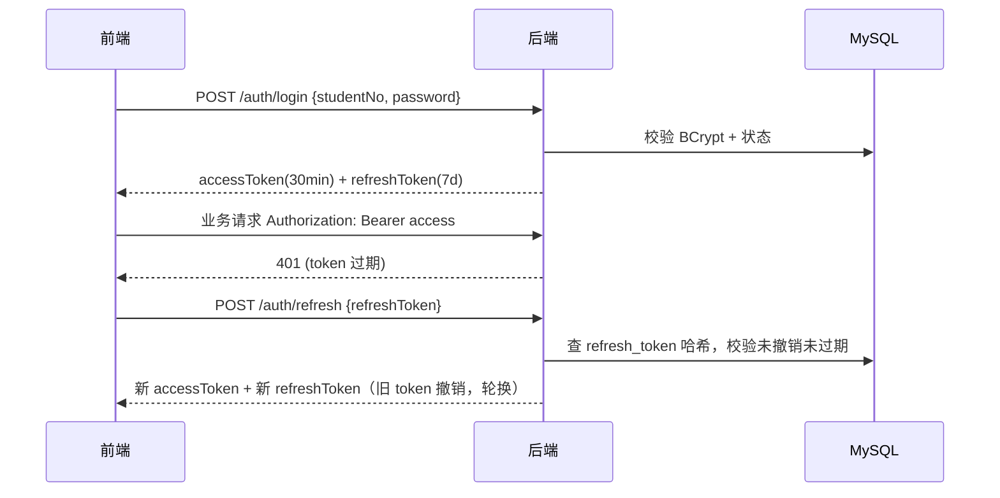

# 校园集 Campus Market — 技术设计文档（TECH_DESIGN）

| 项目 | 内容 |
| --- | --- |
| 对应需求 | `docs/PRD.md` v1.0 |
| 架构形态 | 前后端分离，后端单体分层（Controller / Service / Repository），前端 SPA |
| 运行环境 | JDK 17、Node 20+、MySQL 8.0（本机 3307 端口实例） |

---

## 1. 架构总览



请求链路：`TraceIdFilter → JwtAuthenticationFilter → Controller → Service → Repository`，响应统一经过 `ApiResponse` 包装，异常统一由 `GlobalExceptionHandler` 转换。

---

## 2. 技术选型

| 层 | 选型 | 理由 |
| --- | --- | --- |
| 后端框架 | Spring Boot 3.5.16 | 3.x 稳定线，与 JDK 17 匹配；Initializr 当前默认 4.x，故在 `pom.xml` 中显式锁定 3.5.16 |
| 构建 | Maven Wrapper 3.10.0 | 本机未安装 mvn，wrapper 保证任何人克隆后可直接构建 |
| ORM | Spring Data JPA | 状态机与托管逻辑需要强事务与实体关联；派生查询减少样板 SQL |
| 迁移 | Flyway | 建表脚本进版本库，测试与生产结构一致 |
| 鉴权 | Spring Security + JJWT 0.12 | 无状态 access token，refresh token 落库可撤销 |
| 文档 | springdoc-openapi 2.8 | Swagger UI 便于演示与自测 |
| 前端 | Vue 3 + TS + Vite | 组合式 API 与类型安全；Vite 冷启动快 |
| UI | Element Plus | 表格、表单、上传、时间线等组件完整，减少手写 CSS |
| 图表 | ECharts | 后台看板趋势与分布 |
| 测试 | JUnit 5 + MockMvc + H2 | 不依赖真实 MySQL 即可跑核心流程测试 |

---

## 3. 目录结构

```
final/
├── api/                                  # Spring Boot 后端
│   ├── mvnw / mvnw.cmd / .mvn/
│   ├── pom.xml
│   └── src/
│       ├── main/java/com/campusmarket/
│       │   ├── CampusMarketApplication.java
│       │   ├── common/                   # ApiResponse / ErrorCode / 异常 / 分页 / TraceId
│       │   ├── config/                   # Security / JWT / CORS / OpenAPI / 属性类
│       │   ├── auth/                     # 注册登录、令牌、校园认证
│       │   ├── user/                     # 用户资料、信用档案、通知
│       │   ├── catalog/                  # 分类、商品、图片、收藏、检索
│       │   ├── chat/                     # 会话与消息
│       │   ├── trade/                    # 订单、托管钱包、退款
│       │   ├── review/                   # 双向评价
│       │   ├── credit/                   # 信用分计算
│       │   ├── moderation/               # 举报工单、审核、审计日志
│       │   ├── admin/                    # 后台接口与看板
│       │   └── web/                      # 健康检查、文件上传
│       ├── main/resources/
│       │   ├── application.yml
│       │   └── db/migration/             # V1 建表 / V2 演示数据 / V3 本地商品图集
│       └── test/java/com/campusmarket/
├── web/                                  # Vue 3 前端
│   ├── public/images/items/               # 演示商品插画（16 件 × 3 张 SVG）
│   └── src/{api,components,layouts,router,stores,styles,types,views}
├── docs/{PROMPT.md,PRD.md,TECH_DESIGN.md}
├── scripts/{start-db.ps1,stop-db.ps1,db-init.sql}
├── AGENTS.md
├── README.md
└── .env.example
```

每个业务包内部统一分层：`XxxController → XxxService → XxxRepository → XxxEntity`，请求/响应使用 `dto/` 下的 record，禁止 Controller 直接返回实体。

---

## 4. 数据模型

### 4.1 ER 图



### 4.2 表结构

所有表包含 `created_at DATETIME(6)`，可变表含 `updated_at DATETIME(6)`；金额统一 `DECIMAL(12,2)`；枚举用 `VARCHAR` 存储并在 Java 侧用 enum 校验。

**app_user**

| 列 | 类型 | 说明 |
| --- | --- | --- |
| id | BIGINT PK AI | |
| student_no | VARCHAR(24) UK | 学号 |
| email | VARCHAR(120) UK | 校内邮箱 |
| nickname | VARCHAR(32) | 昵称 |
| password_hash | VARCHAR(100) | BCrypt |
| avatar_url | VARCHAR(255) | |
| bio | VARCHAR(200) | 简介 |
| campus | VARCHAR(50) | 校区 |
| role | VARCHAR(16) | STUDENT / MODERATOR / ADMIN |
| status | VARCHAR(16) | ACTIVE / WARNED / BANNED |
| verified | TINYINT(1) | 校园认证 |
| banned_until | DATETIME(6) | 封禁到期 |
| last_login_at | DATETIME(6) | |

索引：`uk_student_no`、`uk_email`、`idx_role_status`。

**student_verification**：id、user_id、student_no、school_email、code(VARCHAR(8))、attempt_count、status(PENDING/VERIFIED/FAILED)、expires_at、verified_at。索引 `idx_user_status`。

**refresh_token**：id、user_id、token_hash(CHAR(64))、expires_at、revoked(TINYINT)、user_agent。索引 `idx_token_hash`、`idx_user_revoked`。

**category**：id、name、slug、icon、sort_order、enabled、parent_id。索引 `uk_slug`。

**item**

| 列 | 类型 | 说明 |
| --- | --- | --- |
| id | BIGINT PK AI | |
| seller_id | BIGINT FK | |
| category_id | BIGINT FK | |
| title | VARCHAR(80) | |
| description | TEXT | |
| price | DECIMAL(10,2) | |
| original_price | DECIMAL(10,2) | 原价，可空 |
| condition_level | VARCHAR(16) | NEW/LIKE_NEW/GOOD/FAIR |
| campus | VARCHAR(50) | |
| trade_method | VARCHAR(16) | MEETUP/EXPRESS |
| tags | VARCHAR(200) | 逗号分隔 |
| cover_url | VARCHAR(255) | 冗余首图 |
| status | VARCHAR(20) | 见状态机 |
| reject_reason | VARCHAR(200) | |
| view_count / favorite_count | INT | 冗余计数 |
| published_at / sold_at | DATETIME(6) | |
| version | BIGINT | 乐观锁 |

索引：`idx_status_category_created(status, category_id, created_at)`、`idx_seller_status(seller_id, status)`、`idx_price(price)`。

**item_image**：id、item_id、url、sort_order。索引 `idx_item_sort`。

**favorite**：id、user_id、item_id。唯一索引 `uk_user_item`。

**conversation**：id、item_id、buyer_id、seller_id、last_message_at。唯一索引 `uk_item_buyer_seller`。

**message**：id、conversation_id、sender_id、type(TEXT/IMAGE/OFFER)、content、offer_amount、read_flag。索引 `idx_conv_id(conversation_id, id)`。

**orders**

| 列 | 类型 | 说明 |
| --- | --- | --- |
| id | BIGINT PK AI | |
| order_no | VARCHAR(32) UK | CM + yyyyMMdd + 随机 8 位 |
| item_id / buyer_id / seller_id | BIGINT | |
| amount / fee_amount / seller_income | DECIMAL(12,2) | |
| status | VARCHAR(16) | 见状态机 |
| trade_method | VARCHAR(16) | |
| pay_deadline | DATETIME(6) | |
| paid_at / shipped_at / completed_at / cancelled_at | DATETIME(6) | |
| cancel_reason | VARCHAR(200) | |
| version | BIGINT | 乐观锁 |

索引：`uk_order_no`、`idx_buyer_status`、`idx_seller_status`、`idx_status_deadline(status, pay_deadline)`。

**order_status_log**：id、order_id、from_status、to_status、operator_id、remark。索引 `idx_order_id`。

**payment_transaction**：id、trade_no UK、order_id、user_id、type(ESCROW_IN/ESCROW_OUT/REFUND/INCOME/FEE)、amount、status(SUCCESS/FAILED)、remark。

**wallet**：id、user_id UK、balance、frozen、total_income、total_spent、version。

**wallet_ledger**：id、wallet_id、user_id、order_id、type(RECHARGE/ESCROW_OUT/ESCROW_IN/REFUND/INCOME/FEE)、amount、balance_after、remark。索引 `idx_wallet_id`、`idx_user_created`。

**review**：id、order_id、reviewer_id、reviewee_id、item_id、direction(BUYER_TO_SELLER/SELLER_TO_BUYER)、rating(1-5)、tags、comment。唯一索引 `uk_order_reviewer(order_id, reviewer_id)`。

**reputation**：id、user_id UK、credit_score、badge、total_deals、completed_deals、cancelled_deals、refunded_deals、good_reviews、bad_reviews、dispute_count、report_count、avg_rating、updated_at。

**report**：id、reporter_id、target_type(ITEM/USER)、target_id、reason_type(COUNTERFEIT/SCAM/ABUSE/OTHER)、description、evidence_url、status(PENDING/PROCESSING/RESOLVED/REJECTED)、handler_id、handle_remark、handled_at。索引 `idx_status_created`。

**notification**：id、user_id、type(ITEM_AUDIT/ORDER/REPORT/REVIEW/SYSTEM)、title、content、link、read_flag。索引 `idx_user_read(user_id, read_flag)`。

**audit_log**：id、actor_id、action、target_type、target_id、detail(JSON 文本)、ip。索引 `idx_actor_created`、`idx_target`。

---

## 5. 状态机实现

三个枚举 + 一张允许跳转表，统一在 Service 内做守卫，禁止散落的 if。

```java
public enum OrderStatus {
    PENDING_PAY, PAID, SHIPPED, COMPLETED, CANCELLED, REFUNDING, REFUNDED
}

public final class OrderStatusMachine {
    private static final Map<OrderStatus, Set<OrderStatus>> ALLOWED = Map.of(
        PENDING_PAY, Set.of(PAID, CANCELLED),
        PAID,        Set.of(SHIPPED, REFUNDING),
        SHIPPED,     Set.of(COMPLETED, REFUNDING),
        REFUNDING,   Set.of(REFUNDED, PAID),
        COMPLETED,   Set.of(),
        CANCELLED,   Set.of(),
        REFUNDED,    Set.of()
    );

    public static void assertTransition(OrderStatus from, OrderStatus to) {
        if (!ALLOWED.getOrDefault(from, Set.of()).contains(to)) {
            throw new BusinessException(ErrorCode.CONFLICT,
                "订单状态不允许该操作: " + from + " -> " + to);
        }
    }
}
```

- 商品：`ItemStatus` 允许表同构，`DRAFT/REJECTED/ON_SALE` 可编辑，`LOCKED/SOLD` 锁定编辑。
- 举报：`ReportStatus` 允许表，`PENDING → PROCESSING → RESOLVED|REJECTED`。
- 每次跳转同时写 `order_status_log`（订单）或 `audit_log`（审核/封禁）。

---

## 6. 资金托管与结算

### 6.1 账户模型

- 每个用户注册时创建 `wallet`（余额 0）与 `reputation`（信用分 80）。
- 系统用户 `id=1`（`platform`，角色 ADMIN）持有平台钱包，手续费入此账户。
- `balance` 为可用余额，`frozen` 为托管冻结金额。**不变量**：任一时点 `Σ用户 balance + Σ用户 frozen = Σ充值 - Σ退款`。

### 6.2 下单与付款

```text
创建订单 createOrder(itemId):
  校验商品 ON_SALE、卖家 != 买家、买家已认证、信用不处于禁用态
  商品 ON_SALE → LOCKED（乐观锁 @Version，更新失败即并发抢占）
  写 orders(PENDING_PAY, pay_deadline=now+30min) + order_status_log

付款 pay(orderId):
  @Transactional
  加载订单并校验 PENDING_PAY 且未超时
  锁定钱包行（PESSIMISTIC_WRITE），余额不足抛 400「余额不足」
  wallet.balance -= amount; wallet.frozen += amount
  写 wallet_ledger(ESCROW_OUT, -amount, balance_after)
  写 payment_transaction(ESCROW_IN, SUCCESS)
  订单 → PAID，写状态日志
```

### 6.3 确认收货与结算

```text
confirm(orderId):
  @Transactional
  校验操作人是买家、订单 SHIPPED
  fee    = round(amount * 0.02, 2)
  income = amount - fee
  买家钱包 frozen -= amount
  卖家钱包 balance += income
  平台钱包 balance += fee
  写三条流水（INCOME / FEE / ESCROW_IN）与 payment_transaction
  订单 → COMPLETED，商品 LOCKED → SOLD
  重算双方信用分（成交数 +1）
```

### 6.4 退款

```text
refundRequest(orderId):  PAID|SHIPPED → REFUNDING
refundApprove(orderId):  买家 frozen -= amount; balance += amount
                         写 REFUND 流水；订单 → REFUNDED；商品 → ON_SALE
refundReject(orderId):   REFUNDING → PAID
```

### 6.5 并发与一致性

- 订单状态变更使用 `UPDATE ... WHERE id=? AND version=?` 乐观锁，冲突返回 409。
- 钱包扣款使用 `SELECT ... FOR UPDATE`（`@Lock(LockModeType.PESSIMISTIC_WRITE)`），避免同一用户并发下单重复扣款。
- 商品抢占使用乐观锁：并发下单只有一个 `UPDATE` 成功，其余抛「商品已被下单」。
- 所有方法 `@Transactional(rollbackFor = Exception.class)`，异常时订单、钱包、流水一起回滚。

---

## 7. 信用分算法

```java
public int compute(UserStat s, int penalties) {
    if (s.totalReviews() == 0) {
        return clamp(80 - penalties, 0, 100);
    }
    double ratingPart   = s.avgRating() / 5.0 * 100;          // 0..100
    double dealPart     = s.totalDeals() == 0 ? 60.0
                        : s.completedDeals() * 100.0 / s.totalDeals();
    double base         = 0.6 * ratingPart + 0.4 * dealPart;
    return clamp((int) Math.round(base) - penalties, 0, 100);
}
```

- `penalties = 纠纷数 × 5 + 举报成立数 × 3 + 封禁次数 × 10`
- 徽章：`>=95 精英 / 85-94 可靠 / 70-84 普通 / <70 观察期`
- 触发重算的时机：订单完成、退款完成、评价写入、举报成立、封禁/解封。
- 发布限制在 `ItemService.create` 中校验：`<60` 拒绝；`60-89` 在售 ≤ 3；`>=90` 不限。

---

## 8. 认证与鉴权



- JWT Payload：`sub=userId`、`role`、`verified`、`iss=campus-market`、`exp`。
- `JwtAuthenticationFilter` 解析后写入 `SecurityContext`，principal 为 `AuthUser(id, role, verified)`。
- `@PreAuthorize("hasAnyRole('MODERATOR','ADMIN')")` 保护后台接口；业务内再用 `assertOwner` 校验归属。
- refresh token 仅存 SHA-256 哈希，退出登录撤销全部 token。
- 密码强度：8-32 位，至少包含字母与数字。

---

## 9. 接口规范

### 9.1 统一响应

```json
{ "code": 0, "message": "ok", "data": { }, "traceId": "9f2c1a4b" }
```

- `code=0` 成功；`40000` 参数错误；`40001` 业务错误；`40100/40101/40102` 未认证/过期/无效；`40300` 无权限；`40400` 不存在；`40900` 状态冲突；`50000` 服务器错误。
- HTTP 状态码与业务码同时有意义：前端既看 HTTP 也看 `code`。
- 分页响应 `data = { list, total, page, size, pages }`，请求参数统一 `page`（从 1 开始）、`size`（默认 10，上限 50）。

### 9.2 接口一览

| 模块 | 方法与路径 | 说明 |
| --- | --- | --- |
| 认证 | POST `/api/v1/auth/register` | 注册 |
| 认证 | POST `/api/v1/auth/login` | 登录 |
| 认证 | POST `/api/v1/auth/refresh` | 刷新令牌（轮换） |
| 认证 | POST `/api/v1/auth/logout` | 退出并撤销 refresh |
| 认证 | POST `/api/v1/auth/verification/send` | 发送认证验证码 |
| 认证 | POST `/api/v1/auth/verification/confirm` | 提交验证码 |
| 认证 | GET `/api/v1/auth/me` | 当前登录人 |
| 用户 | GET `/api/v1/users/{id}/profile` | 公开信用档案 |
| 用户 | GET `/api/v1/users/me` | 当前登录人资料 |
| 用户 | PUT `/api/v1/users/me` | 修改资料 |
| 用户 | PUT `/api/v1/users/me/password` | 修改密码 |
| 通知 | GET `/api/v1/notifications` | 分页列表 |
| 通知 | GET `/api/v1/notifications/unread-count` | 未读数 |
| 通知 | POST `/api/v1/notifications/{id}/read` | 单条已读 |
| 通知 | POST `/api/v1/notifications/read-all` | 全部已读 |
| 钱包 | GET `/api/v1/wallet` | 余额与冻结 |
| 钱包 | GET `/api/v1/wallet/ledger` | 流水分页 |
| 钱包 | POST `/api/v1/wallet/recharge` | 演示充值 |
| 分类 | GET `/api/v1/categories` | 启用分类树 |
| 分类 | POST/PUT/DELETE `/api/v1/admin/categories` | 管理（ADMIN） |
| 商品 | POST `/api/v1/items` | 创建草稿 |
| 商品 | PUT `/api/v1/items/{id}` | 编辑 |
| 商品 | GET `/api/v1/items` | 检索分页 |
| 商品 | GET `/api/v1/items/{id}` | 详情（浏览量 +1） |
| 商品 | GET `/api/v1/items/mine` | 我的商品 |
| 商品 | GET `/api/v1/items/seller/{sellerId}` | 某卖家在售商品 |
| 商品 | POST `/api/v1/items/{id}/submit` | 提交审核 |
| 商品 | POST `/api/v1/items/{id}/off-shelf` | 下架 |
| 商品 | GET `/api/v1/items/{id}/related` | 同类推荐 |
| 收藏 | POST/DELETE `/api/v1/items/{id}/favorite` | 收藏切换 |
| 收藏 | GET `/api/v1/favorites` | 我的收藏 |
| 文件 | POST `/api/v1/files` | 上传图片，返回 URL |
| 会话 | POST `/api/v1/conversations` | 按商品创建/复用会话 |
| 会话 | GET `/api/v1/conversations` | 会话列表（含未读） |
| 消息 | GET `/api/v1/conversations/{id}/messages` | 增量拉取（afterId） |
| 消息 | POST `/api/v1/conversations/{id}/messages` | 发送文本/报价 |
| 消息 | POST `/api/v1/conversations/{id}/read` | 标记已读 |
| 订单 | POST `/api/v1/orders` | 下单锁定商品 |
| 订单 | GET `/api/v1/orders` | 我买到的/我卖出的 |
| 订单 | GET `/api/v1/orders/{id}` | 详情 + 状态日志 |
| 订单 | POST `/api/v1/orders/{id}/pay` | 托管付款 |
| 订单 | POST `/api/v1/orders/{id}/cancel` | 取消 |
| 订单 | POST `/api/v1/orders/{id}/ship` | 发货/约面交 |
| 订单 | POST `/api/v1/orders/{id}/confirm` | 确认收货 |
| 订单 | POST `/api/v1/orders/{id}/refund` | 申请退款 |
| 订单 | POST `/api/v1/orders/{id}/refund/approve` | 同意退款 |
| 订单 | POST `/api/v1/orders/{id}/refund/reject` | 拒绝退款 |
| 评价 | POST `/api/v1/orders/{id}/reviews` | 双向评价 |
| 评价 | GET `/api/v1/orders/{id}/reviews` | 该订单的评价 |
| 评价 | GET `/api/v1/users/{id}/reviews` | 收到的评价 |
| 举报 | POST `/api/v1/reports` | 举报商品/用户 |
| 举报 | GET `/api/v1/reports/mine` | 我提交的举报 |
| 后台 | GET `/api/v1/admin/items/pending` | 审核队列 |
| 后台 | POST `/api/v1/admin/items/{id}/approve` | 通过 |
| 后台 | POST `/api/v1/admin/items/{id}/reject` | 驳回（理由必填） |
| 后台 | GET `/api/v1/admin/reports` | 工单列表 |
| 后台 | POST `/api/v1/admin/reports/{id}/claim` | 领取 |
| 后台 | POST `/api/v1/admin/reports/{id}/resolve` | 裁定成立 |
| 后台 | POST `/api/v1/admin/reports/{id}/reject` | 驳回工单 |
| 后台 | GET `/api/v1/admin/users` | 用户检索 |
| 后台 | POST `/api/v1/admin/users/{id}/warn` | 警告 |
| 后台 | POST `/api/v1/admin/users/{id}/ban` | 封禁 |
| 后台 | POST `/api/v1/admin/users/{id}/unban` | 解封 |
| 后台 | PUT `/api/v1/admin/users/{id}/role` | 角色调整 |
| 后台 | GET `/api/v1/admin/dashboard/*` | 看板数据 |
| 后台 | GET `/api/v1/admin/audit-logs` | 审计日志 |

完整字段以 Swagger UI（`http://localhost:8080/swagger-ui.html`）为准，代码中的 DTO 是唯一实现来源。

---

## 10. 文件上传

- `POST /api/v1/files`（`multipart/form-data`，字段名 `file`），登录用户可用。
- 校验：扩展名 `jpg/jpeg/png/webp`，MIME 白名单，单文件 ≤ 5MB。
- 存储：`{app.upload.dir}/{yyyyMM}/{uuid}.{ext}`，返回 `/api/v1/files/{yyyyMM}/{uuid}.{ext}`。
- 静态映射由 `WebConfig#addResourceHandlers` 完成，无需经 Controller 转发。

---

## 11. 定时任务

| 任务 | 频率 | 行为 |
| --- | --- | --- |
| `OrderTimeoutJob#cancelExpiredOrders` | 固定延迟 60s（首次延迟 30s） | 扫描 `PENDING_PAY` 且 `pay_deadline < now` 的订单，取消并释放商品回 `ON_SALE` |

使用 `@Scheduled` + `@EnableScheduling`，任务方法内再校验一次状态（幂等）。

当前只注册了订单超时这一个定时任务，另两件事不依赖定时器：

- 认证验证码过期在 `AuthService` 校验时按 `expires_at` 惰性判断（有效期 10 分钟、最多 5 次尝试），不需要扫描任务。
- 「热度」排序在检索查询里直接按 `view_count` / `favorite_count` 排序，没有独立权重字段，因此没有热度刷新任务。

---

## 12. 前端设计

```
web/src/
├── api/           # 按模块封装的 axios 请求（auth/item/order/chat/admin...）
├── components/    # ItemCard / StatusTag / EmptyState / UploadImages / CreditBadge
├── composables/   # usePagination（page/size/total/loading）
├── layouts/       # StudentLayout（顶栏+侧边）/ AdminLayout（侧边菜单）
├── router/        # 路由表 + meta.roles 守卫
├── stores/        # auth / notification / chat
├── types/         # 与后端 DTO 对齐的 TS 类型
├── views/         # student/* 与 admin/*
└── styles/        # 变量、重置、通用类
```

关键点：

- `api/http.ts`：请求带 `Authorization`；响应拦截器判断 `code !== 0` 抛错；401 时用 refreshToken 换新并重放原请求，刷新失败则清空登录态回登录页；并发 401 只触发一次刷新。
- `router`：`meta.roles=['MODERATOR','ADMIN']`，守卫里校验 `authStore.role`，未登录跳 `/login?redirect=`。
- 列表页统一 `usePagination` 组合式函数（page/size/total/loading）。
- 表单统一 Element Plus `el-form` + 规则校验，提交按钮 `:loading`。
- 状态展示统一 `StatusTag` 组件，颜色与枚举一一映射。

### 12.1 视觉规范

样式集中在 `web/src/styles/index.css`，`:root` 里定义设计 token，再据此覆盖 Element Plus 变量（`--el-color-primary` 等），页面与组件只引用 token，不写死色值。

| 类别 | token | 用途 |
| --- | --- | --- |
| 底色 | `--paper` / `--paper-deep` / `--card` | 页面纸张底色、区块底色、卡片 |
| 文本 | `--ink` / `--ink-soft` / `--muted` | 标题、正文、辅助说明 |
| 品牌 | `--brand` / `--brand-deep` / `--brand-soft` / `--pop` / `--gold` | 墨绿主色、悬停深色、浅底、柿子橙点缀、金牌 |
| 结构 | `--line` / `--line-strong` / `--radius-sm` / `--radius` / `--radius-lg` | 描边与圆角 |
| 阴影 | `--shadow-sm` / `--shadow` / `--shadow-lg` / `--ring` | 卡片、弹层、聚焦环 |
| 字体 | `--font-display` / `--font-sans` / `--font-num` | 标题衬线体、正文无衬线、数字专用 |

- 数字排版：金额（`.price`）与统计值（`.stat-card .value`）用 `--font-num` 并设 `font-variant-numeric: lining-nums tabular-nums`；Georgia 默认是旧式数字（0、1、2 偏矮），混排时高低不齐，因此数字不走 `--font-display`。
- 复用类：`.section-head` 区块标题、`.item-card` 商品卡（成色角标 + hover 上浮 + 图片缩放）、`.empty-box` 空态、`.detail-panel` 详情页右侧信息栏（桌面吸顶）、`.gallery-main` / `.gallery-thumbs` 图集。
- 商品图集随前端分发：`web/public/images/items/{slug}-{1..3}.svg`，每件商品 3 张，不依赖外网图床。

---

## 13. 测试策略

| 层次 | 工具 | 覆盖 |
| --- | --- | --- |
| 单元 | JUnit 5 | 状态机允许/禁止跳转、信用分计算、手续费四舍五入 |
| 集成 | MockMvc + H2 | 注册登录与令牌刷新、发布审核、下单付款确认收货全链路、越权访问、重复确认收货 |
| 数据 | Flyway + H2（兼容模式） | 迁移脚本可执行性（MySQL 方言差异部分在 MySQL 手测） |

当前测试集中在 `CampusMarketFlowTest` 一个类里，按流程拆成 4 个用例：注册与校园认证、托管交易结算与评价改分、退款退回托管并恢复商品、举报处理与低信用禁止发布。集成测试使用 `@SpringBootTest` + `@AutoConfigureMockMvc` + `@ActiveProfiles("test")`，`application-test.yml` 指向 H2 内存库并关闭 Flyway（用 `ddl-auto=create-drop`）。

---

## 14. 运行手册

### 14.1 数据库

本机 MySQL80 服务的注册信息指向已不存在的配置文件，且启动需要管理员权限，因此项目使用独立实例（数据目录不在中文路径下，避免 MySQL 无法启动）：

```powershell
# 启动（端口 3307，无密码 root 仅本机）
.\scripts\start-db.ps1

# 初始化库与账号（首次）
mysql -u root -h 127.0.0.1 -P 3307 < scripts\db-init.sql

# 停止
.\scripts\stop-db.ps1
```

应用账号：`campus / Campus@2026`，库：`campus_market`，测试库：`campus_market_test`。

### 14.2 后端

```powershell
cd api
.\mvnw.cmd spring-boot:run          # 开发启动
.\mvnw.cmd test                    # 测试
.\mvnw.cmd -DskipTests package     # 打包 target/api-0.0.1-SNAPSHOT.jar
```

### 14.3 前端

```powershell
cd web
npm install
npm run dev        # http://localhost:5173
npm run build      # 产物 dist/
```

Vite 代理 `/api` → `http://localhost:8080`，无需处理跨域；后端也已开启 CORS。

### 14.4 环境变量

| 变量 | 默认值 | 说明 |
| --- | --- | --- |
| `DB_HOST` / `DB_PORT` | 127.0.0.1 / 3307 | 数据库地址 |
| `DB_NAME` | campus_market | 库名 |
| `DB_USERNAME` / `DB_PASSWORD` | campus / Campus@2026 | 账号 |
| `JWT_SECRET` | 内置开发密钥 | 生产必须替换 |
| `UPLOAD_DIR` | ./uploads | 上传目录 |
| `CORS_ORIGINS` | http://localhost:5173 | 允许来源 |
| `SERVER_PORT` | 8080 | 后端端口 |

---

## 15. 已知限制与后续演进

- 聊天为 REST 轮询（5 秒），实时性一般，P1 换 WebSocket。
- 上传使用本地磁盘，多实例部署需换对象存储。
- 无 Redis，令牌黑名单以数据库 `revoked` 字段实现。
- 数据看板为实时聚合查询，数据量大时应加物化统计表。
